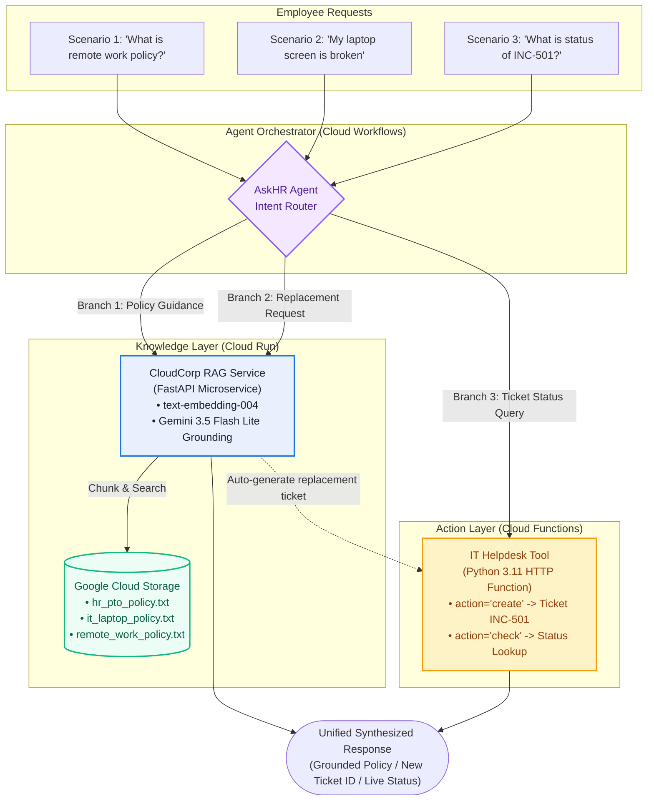
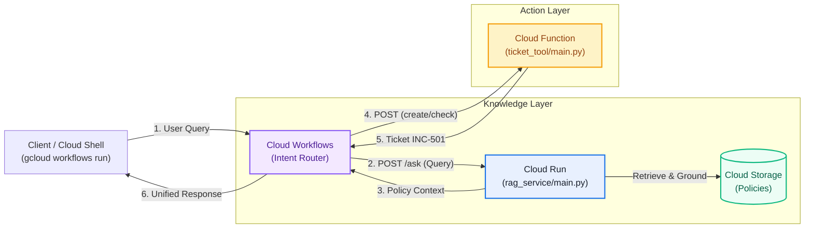

# LLMs on GCP: From RAG to Agentic AI (3-Hour Hands-On Lab)

**Session Duration:** 3.0 Hours (180 Minutes)  
**Author:** [Ujala Jha](https://ujalajha.me) (`ujalajha.me`)  
**Enterprise Use Case:** CloudCorp Smart Assistant (AskHR Agent)  

---

## Table of Contents
1. [Session Overview & Architecture](#session-overview--architecture)
2. [Budget & Cost Guardrails (< $5.00)](#budget--cost-guardrails---500)
3. [Prerequisites & System Requirements](#prerequisites--system-requirements)
4. [Environment Setup & Dependencies](#environment-setup--dependencies)
   - [⚡ Quickstart: Activate Services via Cloud Shell](#-quickstart-activate-gcp-services-via-cloud-shell-1-command)
   - [Virtual Environment Setup (`venv` vs Colab)](#do-you-need-a-virtual-environment-venv)
   - [Centralized Configuration (`.env`)](#centralized-configuration-env)
   - [Generate Credentials (Cloud Shell & Manual)](#how-to-generate--configure-google_application_credentials-for-local-execution)
5. [Section 1: Ingestion & Document Corpus Setup (20 Mins)](#section-1-ingestion--document-corpus-setup-20-mins)
6. [Section 2: Building Grounded RAG Pipeline (55 Mins)](#section-2-building-grounded-rag-pipeline-55-mins)
7. [Section 3: Extending RAG to an Agentic AI Workflow (25 Mins)](#section-3-extending-rag-to-an-agentic-ai-workflow-25-mins)
8. [Section 4: Production Deployment Track — Serverless Microservices (50 Mins)](#section-4-production-deployment-track--serverless-microservices-50-mins)
   - [🛠️ Step 0: Setup in Cloud Shell Editor (Clone & `cat .env`)](#️-step-0-setup-in-google-cloud-shell-editor-recommended)
   - [Option A: 1-Click Automated Deployment](#option-a-1-click-automated-deployment-script)
   - [Option B: Step-by-Step Manual Deployment](#option-b-step-by-step-manual-deployment-recommended-for-learning)
9. [Section 5: Production Architecture & Cost Controls (20 Mins)](#section-5-production-architecture--cost-controls-20-mins)
10. [Section 6: Mandatory Resource Cleanup (10 Mins)](#section-6-mandatory-resource-cleanup-10-mins)
11. [Troubleshooting & Enterprise Best Practices (Learnings & Gotchas)](#troubleshooting--enterprise-best-practices-learnings--gotchas)
    - [1. Model Availability & Multi-Region (`global` vs `us-central1`)](#1-model-availability--multi-region-architecture-global-vs-us-central1)
    - [2. Cloud Build & Artifact Registry APIs Missing](#2-cloud-build--artifact-registry-apis-missing-on-deploy-from-source)
    - [3. Cloud Shell `.env` Upload Failure & Sourcing](#3-cloud-shell-env-upload-failure--sourcing-gotcha)
    - [4. Cloud Run 500 Error & Container Healthchecks](#4-cloud-run-internal-server-error--container-healthchecks)
    - [5. Sandbox IAM: `setIamPolicy` Denied vs Project IAM](#5-sandbox-iam-restriction-runservicessetiampolicy-denied-vs-project-level-iam)
    - [6. Cloud Workflows CLI Syntax: `--location` vs `--region`](#6-cloud-workflows-cli-syntax---location-vs---region)
    - [7. Cloud Workflows OIDC Token Audience & Token Creator](#7-cloud-workflows-oidc-token-audience-mismatch--token-creator-permissions)
    - [8. Autonomous Tool Calling vs. Conversational Text](#8-autonomous-tool-calling-vs-conversational-text-fallback)
    - [9. Safe `function_call` Inspection in SDK](#9-safe-function_call-inspection-in-vertex-ai-sdk)
    - [10. Dynamic Ticket ID Propagation Across Scenarios](#10-dynamic-ticket-id-propagation-across-scenarios)
    - [11. Service Account Key Traversal (`gcp-key.json`)](#11-seamless-service-account-key-traversal-gcp-keyjson)
    - [12. Standalone Cell Execution Guardrails](#12-standalone-cell-execution-guardrails)
    - [13. macOS zsh `#` Interactive Comment Execution Gotcha](#13-macos-zsh--interactive-comment-execution-gotcha)

---

## Session Overview & Architecture

In this 3-hour workshop, learners build, deploy, and observe a production-ready enterprise GenAI application using **Google Cloud Platform (GCP)** managed services. 

The lab follows a continuous business story: **CloudCorp**, a global enterprise modernizing its internal employee support operations with an intelligent **AskHR Agent**.



```
+-----------------------------------------------------------------------------------------+
|                                    EMPLOYEE QUERIES                                     |
|   [Scenario 1: Policy QA]    |   [Scenario 2: Broken Laptop]   |  [Scenario 3: Status]  |
|  "What is remote work rule?" | "Laptop screen is broken"       | "Status of INC-501?"   |
+------------------------------+---------------------------------+------------------------+
                                               |
                                               v
+-----------------------------------------------------------------------------------------+
|                                      AskHR Agent                                        |
|                          (Orchestrated via Cloud Workflows)                             |
|                                                                                         |
|       [Intent: Policy QA]          [Intent: Damaged Device]        [Intent: Ticket ID]  |
|               |                                |                            |           |
+---------------+--------------------------------+----------------------------+-----------+
                |                                |                            |
                v                                v                            |
+---------------------------------------------------------------+             |
|                 KNOWLEDGE LAYER: RAG SERVICE                  |             |
|                    (Cloud Run Microservice)                   |             |
|                                                               |             |
|  • Semantic Chunking via '\n---'                              |             |
|  • Embeddings: Vertex AI text-embedding-004                   |             |
|  • Reasoning: Gemini 3.5 Flash Lite Grounding                      |             |
|  • Source Corpus: Google Cloud Storage (GCS)                  |             |
+---------------------------------------------------------------+             |
                |                                |                            |
                | (Returns Policy)               | (Auto-triggers             |
                |                                |  ticket creation)          |
                |                                v                            v
                |               +---------------------------------------------------------+
                |               |                ACTION LAYER: IT TOOL                    |
                |               |              (Cloud Functions 2nd Gen)                  |
                |               |                                                         |
                |               |  • action="create" -> Creates ticket INC-501 for loaner |
                |               |  • action="check"  -> Queries live ticket status & ETA  |
                |               +---------------------------------------------------------+
                |                                                |
                v                                                v
+-----------------------------------------------------------------------------------------+
|                               UNIFIED SYNTHESIZED RESPONSE                              |
|   Scenario 1: Grounded Remote Work Policy (3 days/wk, 10-3 core hours, $500 stipend)    |
|   Scenario 2: Hardware Policy + Newly Generated Ticket INC-501 + Loaner Pickup Protocol |
|   Scenario 3: Live Helpdesk Progress (Approved, Assigned: Floor 2 Desk, ETA: 24 Hours)  |
+-----------------------------------------------------------------------------------------+
```

### The Three Operational Scenarios

1. **Scenario 1 — Pure Policy Grounding (RAG Path):**
   * **User Asks:** *"What is remote work policy?"*
   * **AskHR Agent Routing:** Directs query to the RAG knowledge layer. Cites CloudCorp's hybrid guidelines: employees can work remotely up to 3 days per week with core hours 10 AM to 3 PM and a $500 home office stipend. Zero external tool calls.
2. **Scenario 2 — Equipment Malfunction $\to$ RAG Policy + Autonomous Ticket Creation (Agentic Path):**
   * **User Asks:** *"My laptop screen is broken and flickering, what should I do?"*
   * **AskHR Agent Routing:** Retrieves IT hardware policy confirming screen fractures qualify for expedited replacement, automatically invokes the helpdesk tool to generate replacement ticket **`INC-501`**, and instructs the employee to pick up an emergency loaner at the Floor 2 Tech Depot.
3. **Scenario 3 — Live Incident Status Check (Tool Path):**
   * **User Asks:** *"What is the status of my ticket INC-501?"*
   * **AskHR Agent Routing:** Extracts incident identifier `INC-501`, queries the live helpdesk database, and returns real-time progress (`Status: Created / Approved for Loaner`, `Assigned: Hardware Desk`, `ETA: 24h`).

---

## Budget & Cost Guardrails 

This workshop is engineered to execute safely with minimal to no cost:

| GCP Service | Lab Usage Configuration | Cost Model / Free Tier | Projected Cost |
| :--- | :--- | :--- | :--- |
| **Cloud Storage** | 1 regional bucket, 3 policy text files (< 100 KB total) | $0.02 / GB / mo | **<$0.001** |
| **Vertex AI Embeddings** | `text-embedding-004` (~25 chunks embedded across lab) | $0.000025 per 1,000 characters | **<$0.002** |
| **Vertex AI Gemini** | `gemini-3.5-flash-lite` (~30 queries during testing) | $0.075 / 1M input tokens, $0.30 / 1M output tokens | **<$0.03** |
| **Cloud Run** | 1 service, 512 MiB RAM, 1 vCPU, min-instances=0 | First 2M requests & 180,000 vCPU-sec free/mo | **$0.00** |
| **Cloud Functions** | 1 function, 256 MiB RAM, min-instances=0 | First 2M invocations free/mo | **$0.00** |
| **Cloud Workflows** | ~15 test executions (under 100 steps) | First 5,000 internal steps free/mo | **$0.00** |
| **Total Estimated Spend**| | | **~$0.05 – $0.20** |

> [!WARNING]
> **Vector Search Endpoint Cost Trap:** In full production, Vertex AI Vector Search deploys to dedicated VM nodes (`e2-standard-2`) costing ~$0.25 to $0.35/hour that **do not scale down to zero**. To eliminate lingering charges, our hands-on lab runs vector cosine similarity in memory on Cloud Run / Colab, while the lecture explains how dedicated Vector Search endpoints operate at scale.

---

## Prerequisites & System Requirements

Before beginning the workshop, review the following account, runtime, and developer environment requirements:

### 1. Developer Environment & IDE (Choose One)

| Environment / IDE | Recommendation | When to Use | Setup Notes |
| :--- | :--- | :--- | :--- |
| **Google Cloud Shell & Cloud Shell Editor** | 🌟 **Top Recommendation** | Fastest zero-install setup directly in browser | Pre-installed with `gcloud`, `git`, `python3.11`, `curl`, and a browser-based VS Code interface. No local installation required! |
| **VS Code / Cursor (Local)** | Recommended for Local Dev | Developing and debugging locally on your laptop | Requires **Python extension** (`ms-python.python`) and **Jupyter extension** (`ms-toolsai.jupyter`) for opening `.ipynb` notebooks. |
| **Google Colab** | Recommended for Notebook Track | Running only the interactive notebooks (`notebooks/`) | Zero-install cloud Jupyter runtime. Works directly with `google.colab.auth.authenticate_user()`. |
| **PyCharm (Professional / Community)** | Optional | JetBrains IDE preference | Configure Python 3.10 or 3.11 virtual environment as the project interpreter. |

---

### 2. Runtime & Software Requirements

* **Python Runtime:**
  * **Required Version:** **Python 3.10** or **Python 3.11** *(Python 3.11 strongly recommended)* to match the Cloud Functions 2nd Gen runtime (`python311`) and Cloud Run container.
  * Check version: `python3 --version`
* **Python Package Manager (`pip`):**
  * `pip >= 23.0`
  * Check version: `pip --version`
* **Google Cloud SDK (`gcloud` CLI):**
  * Version: **`gcloud >= 480.0.0`** (Pre-installed in Google Cloud Shell).
  * Check version: `gcloud --version`
  * If running locally, install via [Google Cloud SDK Installation Guide](https://cloud.google.com/sdk/docs/install) or on macOS: `brew install google-cloud-sdk`.
* **Git CLI:**
  * `git >= 2.30.0` for cloning and managing the lab repository.
  * Check version: `git --version`
* **HTTP Client (`curl`):**
  * Pre-installed on macOS, Linux, and Cloud Shell for running REST verification smoke tests against deployed microservices.

---

### 3. Google Cloud Platform (GCP) Account & Access

* **Active GCP Project:** An active Google Cloud project with billing enabled (e.g. standard personal GCP account, or student sandbox project provided by UpGrad / NuveLabs / Qwiklabs).
* **IAM Permissions:** Your account should have **`Editor`** (`roles/editor`) or **`Owner`** access to enable APIs, create Cloud Storage buckets, deploy Cloud Run services, deploy Cloud Functions, and register Cloud Workflows.
* **Target GCP Region:** **`us-central1`** (Iowa) is used throughout this workshop for low cost and immediate availability of Vertex AI `text-embedding-004` and Cloud Storage. Foundation model reasoning uses the **`global`** endpoint (`gemini-3.5-flash-lite`).

---

### 4. Operating System Compatibility

* **macOS:** Fully compatible with default `zsh` or `bash`.
* **Linux (Ubuntu, Debian, RedHat):** Fully compatible with `bash`.
* **Windows:**
  * **Recommended:** Use **Google Cloud Shell** directly in Chrome/Edge, or use **WSL2 (Windows Subsystem for Linux)** with Ubuntu.
  * *Avoid running bash deployment scripts (`.sh`) directly in native Windows Command Prompt (cmd) or Windows PowerShell.*
* **Hardware Requirements:** Minimal! 4 GB RAM, 2 CPU cores, and 1 GB available disk space. All heavy embedding calculations and LLM reasoning run in Google Cloud's Vertex AI data centers—not on your local machine.

---

## Environment Setup & Dependencies

### ⚡ Quickstart: Activate GCP Services via Cloud Shell (1 Command)

Open **Google Cloud Shell** (click the `>_` terminal icon in the top-right navbar of the [Google Cloud Console](https://console.cloud.google.com/)) and run this one-liner to activate all required APIs:

```bash
# 1. Set your active Project ID
export PROJECT_ID="your-gcp-project-id"
gcloud config set project $PROJECT_ID

# 2. Enable Vertex AI, Cloud Storage, Serverless, and Build APIs
gcloud services enable \
  aiplatform.googleapis.com \
  storage.googleapis.com \
  run.googleapis.com \
  cloudfunctions.googleapis.com \
  workflows.googleapis.com \
  artifactregistry.googleapis.com \
  cloudbuild.googleapis.com

echo "✅ All CloudCorp workshop services successfully activated for $PROJECT_ID!"
```

> [!TIP]
> **Running locally on your laptop without `gcloud` installed?** You can create your Service Account and download its JSON key directly from Cloud Shell in 10 seconds:
> ```bash
> # Create Service Account with Editor role
> gcloud iam service-accounts create cloudcorp-lab-sa --display-name="CloudCorp Lab SA"
> gcloud projects add-iam-policy-binding $PROJECT_ID \
>   --member="serviceAccount:cloudcorp-lab-sa@${PROJECT_ID}.iam.gserviceaccount.com" \
>   --role="roles/editor"
> 
> # Create key and download directly to your laptop
> gcloud iam service-accounts keys create gcp-key.json \
>   --iam-account="cloudcorp-lab-sa@${PROJECT_ID}.iam.gserviceaccount.com"
> cloudshell download gcp-key.json
> ```

---

### Do You Need a Virtual Environment (`venv`)?
* **If running in Google Colab:** **No `venv` needed.** Colab runs inside an isolated container VM. The notebooks are 100% self-bootstrapping (auto-installing required libraries and auto-populating policy files if running standalone). Just ensure:
  1. Billing is enabled on your Google Cloud project.
  2. The Vertex AI API (`aiplatform.googleapis.com`) and Cloud Storage API (`storage.googleapis.com`) are enabled.
  3. Enter your `PROJECT_ID` in the Colab form field at the top of the notebook.
* **If running locally on your laptop / Mac:** **Yes, using a `venv` is recommended** to prevent package conflicts with your system Python:
  ```bash
  # 1. Create and activate virtual environment
  python3 -m venv .venv
  source .venv/bin/activate

  # 2. Install required workshop dependencies
  pip install -r requirements.txt
  ```

### Centralized Configuration (`.env`)

Depending on your environment, configure `.env` using one of the methods below:

#### Option 1: In Google Cloud Shell (Fastest — One-Command `cat`)
> [!TIP]
> **Why `cat` in Cloud Shell?**  
> Google Cloud Shell's web file upload dialog often suppresses hidden UNIX dotfiles (`.env`) or fails to transfer them from your local machine. Creating it directly in Cloud Shell using `cat` is 100% reliable and automatically pulls your active project ID:

```bash
cat << EOF > .env
PROJECT_ID=$(gcloud config get-value project)
REGION=us-central1
BUCKET_NAME=$(gcloud config get-value project)-cloudcorp-policies
EMBEDDING_MODEL=text-embedding-004
GENERATIVE_MODEL=gemini-3.5-flash-lite
EOF

# Export variables into your Cloud Shell session immediately:
set -a; source .env; set +a
```

#### Option 2: Running Locally on Laptop
Copy the provided `.env.example` to `.env` and fill in your GCP project details:
```bash
cp .env.example .env
```
In `.env`:
```env
PROJECT_ID=your-gcp-project-id
REGION=us-central1
BUCKET_NAME=your-gcp-project-id-cloudcorp-policies
EMBEDDING_MODEL=text-embedding-004
GENERATIVE_MODEL=gemini-3.5-flash-lite

# Optional: Path to local Service Account JSON key (for running locally without gcloud)
# Leave blank if running in Google Colab (Colab uses built-in OAuth popup)
GOOGLE_APPLICATION_CREDENTIALS=
```
*(All notebooks in `notebooks/` automatically detect and load `.env` at runtime!)*

### How to Generate & Configure `GOOGLE_APPLICATION_CREDENTIALS` (For Local Execution)

If running locally on your laptop without the `gcloud` CLI installed, generate a Service Account JSON key using **either** Cloud Shell commands or the manual GCP Console:

#### Option A: Cloud Shell Commands Only (Fastest — 10 Seconds)

Open **Google Cloud Shell** (`>_` icon in top-right of [GCP Console](https://console.cloud.google.com/)) and run:

```bash
# 1. Set your Project ID
PROJECT_ID="your-gcp-project-id"
gcloud config set project $PROJECT_ID

# 2. Create the Service Account
gcloud iam service-accounts create cloudcorp-lab-sa \
  --display-name="CloudCorp Lab Service Account"

# 3. Grant the Editor role (covers Vertex AI and Cloud Storage)
gcloud projects add-iam-policy-binding $PROJECT_ID \
  --member="serviceAccount:cloudcorp-lab-sa@${PROJECT_ID}.iam.gserviceaccount.com" \
  --role="roles/editor"

# 4. Generate the private JSON key
gcloud iam service-accounts keys create gcp-key.json \
  --iam-account="cloudcorp-lab-sa@${PROJECT_ID}.iam.gserviceaccount.com"

# 5. Automatically download the key file to your laptop
cloudshell download gcp-key.json
```

---

#### Option B: Manual Console Steps (Via GCP Web UI)

1. Open [Google Cloud Console](https://console.cloud.google.com/) and select your project.
2. In the navigation menu (☰), go to **IAM & Admin** $\to$ **Service Accounts**.
3. Click **+ CREATE SERVICE ACCOUNT** at the top:
   * **Name:** `cloudcorp-lab-sa`
   * Click **CREATE AND CONTINUE**.
4. **Grant Access:** In the **Select a role** dropdown, choose **Basic** $\to$ **Editor** (or type `Editor`). Click **CONTINUE**, then **DONE**.
5. **Download Key:** Click on the newly created `cloudcorp-lab-sa` email $\to$ go to the **KEYS** tab $\to$ click **ADD KEY** $\to$ **Create new key** $\to$ choose **JSON** $\to$ **CREATE**.

---

#### Step 3: Link Key in `.env`
Place the downloaded file into this project directory as `gcp-key.json` and set it in `.env`:
```env
GOOGLE_APPLICATION_CREDENTIALS=gcp-key.json
```
*(All notebooks in `notebooks/` automatically detect and load this key at runtime on Step 1.2).*

> [!WARNING]
> Never commit your private JSON service account key to Git! Our repository's `.gitignore` already blocks `.env` and `*.json` key files.

---

## Section 1: Ingestion & Document Corpus Setup (20 Mins)

### Concept & Theory
In an enterprise LLM architecture, raw knowledge assets reside in centralized object storage (**Google Cloud Storage**) before vectorization. Documents must be loaded dynamically from the file repository rather than hardcoded in application logic.

### Sample Policy Corpus (`sample_policies/`)
* `hr_pto_policy.txt`: Multi-section HR document covering accrual, 5-day rollover limit, March 31 expiration, medical note requirement (>3 days sick), quarterly financial close blackout periods.
* `it_laptop_policy.txt`: 36-month hardware refresh cycles, damaged equipment replacement procedure, and same-day loaner protocols.
* `remote_work_policy.txt`: Up to 3 days/week remote, core hours 10 AM – 3 PM, $500 annual home office stipend.

### 👉 Hands-On Execution
Open and execute the Section 1 notebook:
➡️ **[`notebooks/01_Section1_Setup_and_Corpus.ipynb`](notebooks/01_Section1_Setup_and_Corpus.ipynb)**

---

## Section 2: Building Grounded RAG Pipeline (30 Mins)

### Concept & Theory
1. **Semantic Section Chunking:** Documents are divided along logical section boundaries (`\n---`) to preserve self-contained legal and operational context.
2. **Asymmetric Embeddings (`text-embedding-004`):**
   * Uses `task_type="RETRIEVAL_DOCUMENT"` when indexing policy chunks into vector space.
   * Uses `task_type="RETRIEVAL_QUERY"` when embedding short user questions.
3. **In-Memory Cosine Similarity:** Fast vector dot-product scoring without recurring cluster charges.
4. **Grounded Generation (Gemini 3.5 Flash Lite):** Retrieved context chunks are injected into Gemini's system prompt with strict anti-hallucination guardrails and source citation tracking (`chunk_id`).

### Sample Test Queries & Grounded Answers
* **Query 1:** *"How many days of PTO can I carry over, and when do they expire?"*  
  ➔ **Grounded Answer:** Cites Section 2: maximum 5 days carry-over, strictly expiring on March 31 of Q1.
* **Query 2:** *"Do I need to submit a doctor's certificate if I take sick leave for 4 days?"*  
  ➔ **Grounded Answer:** Cites Section 4: medical certificate required for illness exceeding 3 consecutive days.
* **Query 3:** *"Can I take 2 weeks off during the end of December?"*  
  ➔ **Grounded Answer:** Cites Section 3: extended leaves prohibited during Q4 financial close blackout (Dec 25-31).

### 👉 Hands-On Execution
Open and execute the Section 2 notebook:
➡️ **[`notebooks/02_Section2_RAG_Pipeline.ipynb`](notebooks/02_Section2_RAG_Pipeline.ipynb)**

*(Note: The exact same chunking and grounded retrieval logic is packaged inside [`rag_service/main.py`](rag_service/main.py) for serverless deployment on Google Cloud Run).*

---

## Section 3: Extending RAG to an Agentic AI Workflow (20 Mins)

### Concept & Theory
Static RAG can only read; it cannot take action, file tickets, or query live databases. An **Agentic AI Workflow** adds:
1. **Autonomous Tool Declarations:** Vertex AI `FunctionDeclaration` defines external tools that Gemini can call.
2. **Tool 1 (`create_it_ticket`):** Automatically creates a replacement incident ticket (`INC-501`) when damaged hardware is reported.
3. **Tool 2 (`lookup_it_ticket`):** Queries live helpdesk status by ticket ID.
4. **Autonomous Reasoning Loop:** Gemini inspects user intent, decides whether tools are required, invokes them, and synthesizes a final response.

### Sample Execution Across the 3 Scenarios
* **Scenario 1 (Pure Policy):** *"What is remote work policy?"* ➔ Gemini answers directly from policy chunks with zero tool invocations.
* **Scenario 2 (Hardware Malfunction):** *"My laptop screen is broken and flickering, what should I do?"* ➔ Gemini retrieves replacement policy, autonomously calls `create_it_ticket`, and returns ticket `INC-501` with Floor 2 loaner pickup steps.
* **Scenario 3 (Status Check):** *"What is the status of my ticket INC-501?"* ➔ Gemini calls `lookup_it_ticket` and returns real-time progress (`Status: Created / Approved for Loaner`).

### 👉 Hands-On Execution
Open and execute the Section 3 notebook:
➡️ **[`notebooks/03_Section3_Agentic_Workflow.ipynb`](notebooks/03_Section3_Agentic_Workflow.ipynb)**

*(Note: In production on GCP, tools run on **Cloud Functions** [`ticket_tool/main.py`](ticket_tool/main.py) and multi-step decisions are orchestrated declaratively via **Cloud Workflows** [`workflows/workflow.yaml`](workflows/workflow.yaml)).*

---

## Section 4: Production Deployment Track — Serverless Microservices (50 Mins)

> [!NOTE]
> **Pedagogical Note for Learners & Instructors:**  
> In Sections 1 through 4, you prototyped, tested, and evaluated RAG and agentic tool-calling interactively inside Python notebooks.  
> In this production track, you deploy that exact same code into live enterprise serverless infrastructure on Google Cloud Platform:
> * **Cloud Run** hosts the containerized FastAPI RAG service (`rag_service/`).
> * **Cloud Functions (2nd Gen)** hosts the lightweight IT helpdesk tool (`ticket_tool/`).
> * **Cloud Workflows** orchestrates the multi-step intent routing and tool execution (`workflows/workflow.yaml`).

### Architecture: How the Live Services Connect



---

### 🛠️ Step 0: Setup in Google Cloud Shell Editor (Recommended)

If you executed Sections 1 through 3 in Google Colab or locally, Section 4 transitions to live cloud serverless infrastructure. The fastest and most reliable way to execute this is inside **Google Cloud Shell Editor** (a full browser-based VS Code environment with pre-authenticated `gcloud`):

1. **Open Google Cloud Shell Editor:**
   In the [Google Cloud Console](https://console.cloud.google.com/), click the **`>_`** terminal icon in the top-right navbar, then click the **Open Editor** button on the Cloud Shell toolbar.

2. **Clone the Repository in Cloud Shell:**
   Open the terminal inside Cloud Shell and clone the lab repository:
   ```bash
   git clone https://github.com/UjalaJha/cloudcorp-llms-on-gcp-lab.git
   cd cloudcorp-llms-on-gcp-lab
   ```
   *(To open this repository in the Editor file explorer sidebar, run: `cloudshell workspace .` or click **File** $\to$ **Open Folder** $\to$ `cloudcorp-llms-on-gcp-lab`)*.

3. **Generate and Source `.env` (Why `cat` is Needed Here):**
   > [!IMPORTANT]
   > **Why is the `cat` step required right here?**  
   > 1. `.env` is in `.gitignore` to prevent leaking cloud secrets, so `git clone` intentionally does not include it.  
   > 2. Uploading a `.env` file from your local laptop through the Cloud Shell web upload dialog often fails or suppresses the file because it is a hidden UNIX dotfile (`.*`).  
   > 
   > Running this one-liner directly in your Cloud Shell terminal creates `.env`, automatically populates your active `PROJECT_ID`, and exports all variables into your shell session in one step:

   ```bash
   cat << EOF > .env
   PROJECT_ID=$(gcloud config get-value project)
   REGION=us-central1
   BUCKET_NAME=$(gcloud config get-value project)-cloudcorp-policies
   EMBEDDING_MODEL=text-embedding-004
   GENERATIVE_MODEL=gemini-3.5-flash-lite
   EOF

   set -a; source .env; set +a
   ```

4. **Inspect the Service Code in the Editor:**
   In the Cloud Shell Editor file tree, you can now inspect the production code you are about to deploy:
   * [`rag_service/main.py`](rag_service/main.py) & [`rag_service/Dockerfile`](rag_service/Dockerfile): Containerized FastAPI RAG service.
   * [`ticket_tool/main.py`](ticket_tool/main.py): Cloud Functions 2nd Gen IT helpdesk tool.
   * [`workflows/workflow.yaml`](workflows/workflow.yaml): Cloud Workflows declarative intent router.

---

### Option A: 1-Click Automated Deployment Script

In **Google Cloud Shell**, run our automated deployment script:
```bash
./deploy_production.sh
```
*(The script automatically reads and exports `PROJECT_ID`, `REGION`, and `BUCKET_NAME` directly from your `.env` file, verifies APIs, deploys Cloud Run, deploys Cloud Function, deploys Cloud Workflows with environment linking, and runs live verification tests across all 3 scenarios).*

---

### Option B: Step-by-Step Manual Deployment (Recommended for Learning)

First, load your environment variables (or auto-create `.env` if not uploaded) and authorize service account permissions upfront:
```bash
# 1. Auto-generate .env if not uploaded to Cloud Shell, then export variables
if [ ! -f .env ]; then
  cat << EOF > .env
PROJECT_ID=$(gcloud config get-value project)
REGION=us-central1
BUCKET_NAME=$(gcloud config get-value project)-cloudcorp-policies
EMBEDDING_MODEL=text-embedding-004
GENERATIVE_MODEL=gemini-3.5-flash-lite
EOF
fi
set -a; source .env; set +a

# 2. Grant project-level invoker & token creator roles (avoids sandbox 403 errors)
gcloud projects add-iam-policy-binding ${PROJECT_ID} \
  --member="serviceAccount:cloudcorp-lab-sa@${PROJECT_ID}.iam.gserviceaccount.com" \
  --role="roles/run.invoker" \
  --quiet

gcloud projects add-iam-policy-binding ${PROJECT_ID} \
  --member="serviceAccount:cloudcorp-lab-sa@${PROJECT_ID}.iam.gserviceaccount.com" \
  --role="roles/iam.serviceAccountTokenCreator" \
  --quiet
```
*(This instantly exports `$PROJECT_ID`, `$REGION`, `$BUCKET_NAME` into your terminal session and ensures your service account has authorization to invoke Cloud Run and generate workflow OIDC tokens).*

#### Step 1: Deploy Cloud Run RAG Service (Knowledge Layer)
The RAG logic from Notebook 2 is packaged inside `rag_service/main.py` with FastAPI and a `Dockerfile`.
Deploy the containerized service:
```bash
gcloud run deploy cloudcorp-rag-service \
  --source=rag_service \
  --region=${REGION:-us-central1} \
  --service-account="cloudcorp-lab-sa@${PROJECT_ID}.iam.gserviceaccount.com" \
  --no-allow-unauthenticated \
  --set-env-vars="PROJECT_ID=${PROJECT_ID},BUCKET_NAME=${BUCKET_NAME:-${PROJECT_ID}-cloudcorp-policies},REGION=${REGION:-us-central1},GENERATIVE_MODEL=gemini-3.5-flash-lite,GENAI_LOCATION=global"
```

Capture the live service URL:
```bash
export RAG_SERVICE_URL=$(gcloud run services describe cloudcorp-rag-service --region=${REGION:-us-central1} --format='value(status.url)')
echo "✅ Cloud Run RAG URL: $RAG_SERVICE_URL"
```

**Quick Smoke Test:**
```bash
curl -X POST "${RAG_SERVICE_URL}/ask" \
  -H "Authorization: Bearer $(gcloud auth print-identity-token)" \
  -H "Content-Type: application/json" \
  -d '{"query": "How many days of PTO can I carry over?"}'
```

---

#### Step 2: Deploy Cloud Function IT Helpdesk Tool (Action Layer)
The helpdesk ticketing tool from Notebook 3 is packaged inside `ticket_tool/main.py` as a serverless 2nd Gen HTTP function.
Deploy the HTTP function:
```bash
gcloud functions deploy cloudcorp-ticket-tool \
  --gen2 \
  --runtime=python311 \
  --source=ticket_tool \
  --entry-point=handle_it_ticket \
  --trigger-http \
  --service-account="cloudcorp-lab-sa@${PROJECT_ID}.iam.gserviceaccount.com" \
  --no-allow-unauthenticated \
  --region=${REGION:-us-central1}
```

> [!NOTE]
> **Encountered `Permission 'run.services.setIamPolicy' denied` during function deploy?**  
> In student and lab sandbox environments (e.g. NuveLabs / UpGrad), individual service-level IAM modification is locked down by GCP organization policies. The function container itself **deploys successfully**! We authorize invocations cleanly in Step 3 via project-level role bindings (`gcloud projects add-iam-policy-binding`).

Capture the live function URI:
```bash
export TICKET_TOOL_URL=$(gcloud functions describe cloudcorp-ticket-tool --region=${REGION:-us-central1} --format='value(serviceConfig.uri)')
echo "✅ Cloud Function Tool URL: $TICKET_TOOL_URL"
```

**Quick Smoke Test:**
```bash
curl -X POST "${TICKET_TOOL_URL}" \
  -H "Authorization: Bearer $(gcloud auth print-identity-token)" \
  -H "Content-Type: application/json" \
  -d '{"action": "create", "summary": "Broken MacBook display", "category": "Hardware Replacement"}'
```

---

#### Step 3: Deploy Cloud Workflows Intent Router (Orchestration Layer)
Deploy the declarative YAML workflow linking Cloud Run and Cloud Functions:  
*(⚠️ **Syntax Note:** Cloud Workflows strictly uses `--location`, NOT `--region`)*
```bash
gcloud workflows deploy cloudcorp-agent-workflow \
  --source=workflows/workflow.yaml \
  --location=${REGION:-us-central1} \
  --service-account="cloudcorp-lab-sa@${PROJECT_ID}.iam.gserviceaccount.com" \
  --set-env-vars="RAG_SERVICE_URL=${RAG_SERVICE_URL},TICKET_TOOL_URL=${TICKET_TOOL_URL}"

echo "✅ Cloud Workflows deployed successfully!"
```

---

#### Step 4: Live Execution Across the 3 Enterprise Scenarios

Now execute the complete agentic pipeline directly from Cloud Shell:

**Scenario 1: Pure Policy Grounding (Zero Tool Calls)**
```bash
gcloud workflows run cloudcorp-agent-workflow \
  --location=${REGION:-us-central1} \
  --data='{"query": "What is remote work policy?"}'
```
*Expected Result:* Routes to Cloud Run RAG service; returns grounded policy with core working hours and equipment stipends.

**Scenario 2: Hardware Incident -> RAG Policy + Automatic Ticket Creation**
```bash
gcloud workflows run cloudcorp-agent-workflow \
  --location=${REGION:-us-central1} \
  --data='{"query": "My laptop screen is broken and flickering, what should I do?"}'
```
*Expected Result:* RAG confirms replacement eligibility ➔ automatically calls Cloud Function to generate ticket `INC-501` ➔ returns Floor 2 loaner pickup instructions.

**Scenario 3: Live Incident Status Lookup**
```bash
gcloud workflows run cloudcorp-agent-workflow \
  --location=${REGION:-us-central1} \
  --data='{"query": "What is the status of my ticket INC-501?", "ticket_id": "INC-501"}'
```
*Expected Result:* Directly calls Cloud Function tool ➔ queries database ➔ returns live progress (`Status: Created / Approved for Loaner`).

---

## Section 5: Production Architecture & Cost Controls (20 Mins)

### Concept & Theory
1. **Latency Profiles:** Standard RAG requires 1 retrieval + 1 LLM call (~1.2s). Agentic workflows require multiple reasoning and tool loops (~4.5s).
2. **Token Amplification:** Agents accumulate conversation history and tool schemas across turns. Guardrails include setting `max_steps=5` and concise tool parameters.
3. **Matryoshka Representation Learning (MRL):** `text-embedding-004` supports truncating 768-dim vectors to 256-dim, slashing memory usage by 66.7% with <1.5% loss in precision.
4. **Managed Vector Search vs. In-Memory:** When scaling to >100,000 vectors, transition from in-memory cosine to **Vertex AI Vector Search** with ScaNN.

### 👉 Hands-On Execution
Open and execute the Section 4 notebook:
➡️ **[`notebooks/04_Section4_Production_and_Costs.ipynb`](notebooks/04_Section4_Production_and_Costs.ipynb)**

---

## Section 6: Mandatory Resource Cleanup (10 Mins)

To ensure zero ongoing charges and guarantee your total workshop bill remains under **$5.00** (projected actual: **<$0.30**), clean up all deployed compute instances, storage, container images, service accounts, and IAM bindings before concluding your session.

### Option A: 1-Click Automated Teardown Script (Recommended)

In **Google Cloud Shell** or your local terminal, run our automated teardown script:
```bash
./cleanup.sh
```
*(The script automatically reads `.env`, deletes Cloud Workflows, Cloud Functions, Cloud Run, Artifact Registry repositories, empties and deletes the GCS bucket, revokes all project-level IAM bindings, deletes the Service Account, and removes any local credential keys).*

---

### Option B: Step-by-Step Manual Teardown

If executing manually in Google Cloud Shell:

```bash
# Ensure environment variables are loaded
set -a; source .env; set +a
SERVICE_ACCOUNT="cloudcorp-lab-sa@${PROJECT_ID}.iam.gserviceaccount.com"

# 1. Delete Serverless Microservices
gcloud workflows delete cloudcorp-agent-workflow --location=${REGION:-us-central1} --quiet 2>/dev/null || true
gcloud functions delete cloudcorp-ticket-tool --region=${REGION:-us-central1} --quiet 2>/dev/null || true
gcloud run services delete cloudcorp-rag-service --region=${REGION:-us-central1} --quiet 2>/dev/null || true

# 2. Delete Artifact Registry Container Repositories (Built by source deploys)
gcloud artifacts repositories delete cloud-run-source-deploy --location=${REGION:-us-central1} --quiet 2>/dev/null || true
gcloud artifacts repositories delete gcf-artifacts --location=${REGION:-us-central1} --quiet 2>/dev/null || true

# 3. Empty and delete Google Cloud Storage bucket
gcloud storage rm -r "gs://${BUCKET_NAME}" 2>/dev/null || gsutil rm -r "gs://${BUCKET_NAME}" 2>/dev/null || true

# 4. Revoke Project-Level IAM Role Bindings
gcloud projects remove-iam-policy-binding "${PROJECT_ID}" \
  --member="serviceAccount:${SERVICE_ACCOUNT}" \
  --role="roles/run.invoker" \
  --quiet 2>/dev/null || true

gcloud projects remove-iam-policy-binding "${PROJECT_ID}" \
  --member="serviceAccount:${SERVICE_ACCOUNT}" \
  --role="roles/iam.serviceAccountTokenCreator" \
  --quiet 2>/dev/null || true

gcloud projects remove-iam-policy-binding "${PROJECT_ID}" \
  --member="serviceAccount:${SERVICE_ACCOUNT}" \
  --role="roles/editor" \
  --quiet 2>/dev/null || true

# 5. Delete Service Account & Secret Credentials
gcloud iam service-accounts delete "${SERVICE_ACCOUNT}" --quiet 2>/dev/null || true
gcloud secrets delete cloudcorp-agent-key --quiet 2>/dev/null || true
rm -f gcp-key.json

echo "=== Cleanup completed! All lab resources, IAM bindings, and credentials successfully removed. ==="
```

---

## Troubleshooting & Enterprise Best Practices (Learnings & Gotchas)

During real-world enterprise deployments and live workshop executions, several subtle GCP SDK behaviors, authentication nuances, and regional model availability policies can arise. The codebase incorporates proactive guardrails for each:

### 1. Model Availability & Multi-Region Architecture (`global` vs `us-central1`)
* **Symptom:** `NotFound: 404 Publisher model ... was not found or your project does not have access to it.`
* **Root Cause:** In modern Google Cloud projects (including educational sandboxes like `upgradlabs-*`), older foundation models (`gemini-1.5-flash`, `gemini-2.5-flash`) or regional endpoints for new foundation models may not be accessible. The production model is **`gemini-3.5-flash-lite`** hosted on the **`global`** endpoint.
* **Resolution:** 
  * Vertex AI Text Embeddings (`text-embedding-004`) and Cloud Storage buckets operate regionally in `us-central1` (`location="us-central1"`).
  * Vertex AI Gemini (`gemini-3.5-flash-lite`) operates globally (`location="global"`).
  * In code, initialize the appropriate location context:
    ```python
    # For Regional Embeddings (us-central1):
    vertexai.init(project=PROJECT_ID, location="us-central1")
    embed_model = TextEmbeddingModel.from_pretrained("text-embedding-004")

    # For Foundation Generative Model (global):
    vertexai.init(project=PROJECT_ID, location="global")
    agent_llm = GenerativeModel("gemini-3.5-flash-lite", tools=[agent_tools])
    ```

### 2. Cloud Build & Artifact Registry APIs Missing on Deploy from Source
* **Symptom:** Interactive prompt during deployment:  
  `API [cloudbuild.googleapis.com] not enabled on project ... Deploying from source requires an Artifact Registry Docker repository to store built containers. Would you like to enable and retry (this will take a few minutes)? (Y/n)?`
* **Root Cause:** Deploying Cloud Run or 2nd Gen Cloud Functions directly from source code (`--source`) automatically invokes Google Cloud Build to construct container images and push them into Artifact Registry. If `cloudbuild.googleapis.com` and `artifactregistry.googleapis.com` are not enabled beforehand, the deployment hangs or fails in non-interactive CI/CD pipelines.
* **Resolution:** Activate both APIs upfront before initiating deployments:
  ```bash
  gcloud services enable cloudbuild.googleapis.com artifactregistry.googleapis.com --quiet
  ```
  *(Both `deploy_production.sh` and Section 4 automated deployment pre-enable these APIs).*

### 3. Cloud Shell `.env` Upload Failure & Sourcing Gotcha
* **Symptom:** `cloud shell is not reading .env`, `PROJECT_ID` evaluates to empty string, or unable to upload `.env` through the Cloud Shell web interface.
* **Root Cause:** 
  1. **Upload Failure:** Cloud Shell's web file upload dialog suppresses hidden UNIX dotfiles (`.*`), preventing users from uploading `.env` directly from their laptop.
  2. **Git Protection:** `.env` is in `.gitignore` to prevent secret leaks, so git clone does not pull it.
  3. **Shell Sourcing:** In Linux/Cloud Shell, simply having a `.env` file does not automatically expose environment variables to commands in your session.
* **Resolution:** 
  1. Bypass the upload menu entirely and create `.env` directly via `cat`:
     ```bash
     cat << EOF > .env
     PROJECT_ID=$(gcloud config get-value project)
     REGION=us-central1
     BUCKET_NAME=$(gcloud config get-value project)-cloudcorp-policies
     EMBEDDING_MODEL=text-embedding-004
     GENERATIVE_MODEL=gemini-3.5-flash-lite
     EOF
     ```
  2. Export variables into your active Cloud Shell terminal session:
     ```bash
     set -a; source .env; set +a
     ```
  *(Note: `./deploy_production.sh` also includes automatic detection and will generate and source `.env` automatically if missing).*

### 4. Cloud Run Internal Server Error & Container Healthchecks
* **Symptom:** `curl -X POST "${RAG_SERVICE_URL}/ask"` returns `500 Internal Server Error`, or Cloud Run logs display:  
  `ValueError: Unsupported region for Vertex AI, select from frozenset({'australia-southeast1', ...})`
* **Root Cause:**
  1. Older pinned versions of `google-cloud-aiplatform` (< 2.0.0) strictly validated regional endpoints against a legacy set and crashed when passed `location="global"`.
  2. Instantiating AI models and downloading tokenizer weights at the top of the file (global module scope) blocks container startup, causing Cloud Run's port healthcheck to time out before FastAPI begins listening.
* **Resolution:**
  1. In [`rag_service/requirements.txt`](rag_service/requirements.txt), require `google-cloud-aiplatform>=2.0.0`.
  2. In [`rag_service/main.py`](rag_service/main.py), use lazy model loading (`get_models()`) and provide lightweight `/` and `/health` endpoints so container health checks return instant HTTP 200 before the first AI prediction is called.

### 5. Sandbox IAM Restriction: `run.services.setIamPolicy` Denied vs Project-Level IAM
* **Symptom:** During `gcloud functions deploy` or `gcloud run services add-iam-policy-binding`:  
  `ERROR: ResponseError: status=[403], message=[Permission 'run.services.setIamPolicy' denied on resource 'projects/.../services/cloudcorp-ticket-tool']`
* **Root Cause:** In educational sandboxes (e.g., UpGrad / NuveLabs), student user accounts are barred by organization policies from modifying resource-level IAM policies (`setIamPolicy`) to prevent exposing services to `allUsers`.
* **Resolution:** 
  1. Do not worry about the deployment warning—the Cloud Function or Cloud Run service has **successfully compiled and deployed**.
  2. Apply the invoker role at the **project level** rather than the individual service level:
     ```bash
     gcloud projects add-iam-policy-binding "$PROJECT_ID" \
       --member="serviceAccount:cloudcorp-lab-sa@${PROJECT_ID}.iam.gserviceaccount.com" \
       --role="roles/run.invoker" \
       --quiet
     ```

### 6. Cloud Workflows CLI Syntax: `--location` vs `--region`
* **Symptom:** `ERROR: (gcloud.workflows.deploy) unrecognized arguments: --region=us-central1`
* **Root Cause:** Unlike `gcloud run` and `gcloud functions` which use the `--region` flag, `gcloud workflows` commands (`deploy`, `run`, `delete`) strictly mandate `--location`.
* **Resolution:** Always pass `--location`:
  ```bash
  gcloud workflows deploy cloudcorp-agent-workflow \
    --source=workflows/workflow.yaml \
    --location=${REGION:-us-central1} \
    ...
  ```

### 7. Cloud Workflows OIDC Token Audience Mismatch & Token Creator Permissions
* **Symptom:** `AuthError: IAM permission denied for service account ... in step handle_pure_rag_flow`.
* **Root Cause:** 
  1. The workflow service account lacks permission to impersonate or create tokens for itself (`roles/iam.serviceAccountTokenCreator`).
  2. When Cloud Workflows makes an authenticated HTTP call to a subpath like `${rag_url + "/ask"}`, by default it mints an OIDC token with the full target URL as the audience. Cloud Run rejects this because its expected audience is the root base service URL (`${rag_url}`).
* **Resolution:** 
  1. Grant the token creator role at the project level:
     ```bash
     gcloud projects add-iam-policy-binding "$PROJECT_ID" \
       --member="serviceAccount:cloudcorp-lab-sa@${PROJECT_ID}.iam.gserviceaccount.com" \
       --role="roles/iam.serviceAccountTokenCreator" \
       --quiet
     ```
  2. In [`workflows/workflow.yaml`](workflows/workflow.yaml), explicitly specify `audience: ${rag_url}` and `audience: ${ticket_url}` in every `auth: type: OIDC` block:
     ```yaml
     call: http.post
     args:
       url: ${rag_url + "/ask"}
       auth:
         type: OIDC
         audience: ${rag_url}
     ```

### 8. Autonomous Tool Calling vs. Conversational Text Fallback
* **Symptom:** Agent responds *"I will go ahead and create an IT incident ticket for you..."* in text, but takes the pure RAG path and never calls the tool.
* **Root Cause:** If system instructions suggest *"explain policy and call create_it_ticket"*, the LLM attempts to output conversational text first. In Vertex AI single-turn generation, if the candidate output contains text, it omits the `function_call` payload.
* **Resolution:** Hardened system instructions with explicit, deterministic rules:
  ```python
  system_instruction=(
      "You are CloudCorp's AskHR & IT Agent.\n"
      "CRITICAL RULES:\n"
      "1. HARDWARE MALFUNCTION / DAMAGE: If an employee reports broken, damaged, or malfunctioning hardware, "
      "you MUST immediately call the `create_it_ticket` tool. Do NOT answer with plain text alone or just promise to create a ticket—invoke create_it_ticket immediately.\n"
      "2. TICKET STATUS LOOKUP: If an employee asks about an existing ticket status, you MUST call `lookup_it_ticket`.\n"
      "3. GENERAL HR QUESTIONS: For general HR policy questions, answer directly from policy context without calling tools."
  )
  ```

### 9. Safe `function_call` Inspection in Vertex AI SDK
* **Symptom:** `AttributeError: 'NoneType' object has no attribute 'name'` at `part.function_call.name`.
* **Root Cause:** In `google-cloud-aiplatform`, a response `Part` always has the attribute `function_call`, but its value is `None` when text is returned. `hasattr(part, "function_call")` evaluates to `True`, causing `part.function_call.name` to crash.
* **Resolution:** Use safe attribute retrieval:
  ```python
  part = response.candidates[0].content.parts[0]
  func_call = getattr(part, "function_call", None)
  if func_call and getattr(func_call, "name", None):
      fn_name = func_call.name
      fn_args = dict(func_call.args)
  ```

### 10. Dynamic Ticket ID Propagation Across Scenarios
* **Symptom:** Scenario 3 checks `What is the status of my ticket INC-501?` and returns `Not Found`.
* **Root Cause:** Hardcoding `INC-501` assumes Scenario 2 always succeeded in generating that exact ID in the current session.
* **Resolution:** Dynamically capture the generated ticket record from Scenario 2 and pass it to Scenario 3, with fallback to pre-seeded records:
  ```python
  created_ticket = run_askhr_agent("My laptop screen is broken and flickering, what should I do?")
  ticket_to_check = created_ticket.get("ticket_id", "INC-402") if created_ticket else "INC-402"
  run_askhr_agent(f"What is the status of my ticket {ticket_to_check}?")
  ```

### 11. Seamless Service Account Key Traversal (`gcp-key.json`)
* **Symptom:** `FileNotFoundError: gcp-key.json` when running from `notebooks/` subfolder.
* **Resolution:** All notebooks include recursive directory traversal (`.`, `..`, `notebooks/`, `~/Documents`) to automatically discover and resolve `gcp-key.json` regardless of whether the notebook kernel was started from project root or inside `notebooks/`.

### 12. Standalone Cell Execution Guardrails
* **Symptom:** `NameError: name 'PROJECT_ID' is not defined` or `NameError: name 'np' is not defined`.
* **Resolution:** Every standalone section notebook now includes independent imports (`import numpy as np`, `import time`, `import os`) and the complete authentication/configuration loader block so any notebook or cell can be run independently in any order.

### 13. macOS zsh `#` Interactive Comment Execution Gotcha
* **Symptom:** `zsh: command not found: #` when copying and pasting multi-line shell snippets.
* **Root Cause:** On macOS, the default `zsh` interactive shell treats `#` as an executable command rather than a comment unless `setopt interactivecomments` is configured in `~/.zshrc`.
* **Resolution:** All multi-line code boxes in the README are cleanly partitioned into pure executable statements without embedded comment lines.

---

### Master All-in-One Notebook
For learners who prefer executing the entire 3-hour workshop inside a single unified Colab file:
➡️ **[`notebooks/00_Full_Master_Lab.ipynb`](notebooks/00_Full_Master_Lab.ipynb)**
